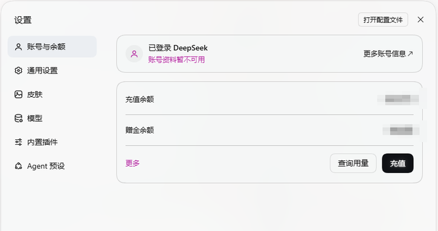

# DSH 插件集

给 DeepSeek Harness 的 Web 界面补三个小功能：**侧边栏账号余额**、**整站皮肤（可换背景图）**、**会话额度消耗**。



## 插件一览

| 插件 | 作用 | 出现在 |
|---|---|---|
| [`账号余额`](dsh-account-balance) | 随时看到账号余额，消耗时浮出增量 | 左侧边栏底部 |
| [`皮肤`](dsh-skins) | 多套配色、自定义背景图、文字对比度 | 设置 → 皮肤 |
| [`额度消耗`](dsh-quota-meter) | 本会话已花多少额度 | 输入框下方 |

三个插件互相独立，可以只装其中一个。

## 使用

### 账号余额

侧栏底部常驻显示 `¥12.34`，有赠送额度时追加绿色 `+¥5.00`。

- 点击立即刷新，悬停可看充值余额、赠送余额与更新时间
- 页面可见时每 30 秒自动刷新；余额变化时右侧浮出 `−¥0.03` 提示
- 侧栏收窄成图标栏时只留钱包图标，金额在悬停提示里
- 未登录、读取失败都有独立提示，点一下重试

### 皮肤

设置 → 皮肤，三块内容：

- **配色皮肤**：默认 / 极光青 / 暖沙 / 森林 / 霓虹紫，每套都有浅色和深色两版，跟随「通用设置 → 外观」的明暗选择。
- **背景图**：选本地图片，或粘贴图片链接。
  - 本地图片自动压到最长边 2560；带透明通道的图会保留透明（不再被填黑）
  - 图片链接按原图加载，不占本机存储
  - 可调 `暗化`（蒙层深浅）、`面板通透度`（卡片/侧栏有多透）、`遮罩浓度`（打开设置时背景雾化程度）
- **文字**：`面板明暗` 决定玻璃底是深是浅，`文字配色` 决定文字颜色（自动 / 高对比 / 柔和 / 自定义取色），专治背景图上的灰字看不清。

### 额度消耗

输入框下方一行 `本会话已用 ¥0.03`，从本会话第一条消息开始计算；任务运行时自动刷新，任务结束后补读一次。

## 安装

前提：已安装 DeepSeek Harness，并能使用插件管理器（`plugin_manager`）。

```
plugin_manager install_bundle target=<本仓库路径>/dsh-account-balance
plugin_manager install_bundle target=<本仓库路径>/dsh-skins
plugin_manager install_bundle target=<本仓库路径>/dsh-quota-meter
```

装完刷新页面即可看到效果；插件的开关也在 设置 → 插件 里。

## 修改后重新安装

改代码后必须重装一次，浏览器才会加载新的客户端包：

```
plugin_manager remove_bundle  target=@local/dsh-account-balance
plugin_manager install_bundle target=<本仓库路径>/dsh-account-balance
```

（只改 `index.js` 这类 Host 端代码时无需重装。）

## 说明

- 三个插件只用浏览器本地存储（`localStorage` / IndexedDB），不上传图片、不联网保存数据。
- 余额通过 Harness 自带的账号接口读取，浏览器侧拿不到登录凭据。
- 皮肤、壁纸、文字配色按浏览器保存，换浏览器或清缓存会回到默认。

## 已知限制

- 背景图依赖界面用 `--dsw-alias-bg-base` 铺画布，个别自带不透明底色的区域不会透出图片。
- 远程图片若不允许跨域读取，无法测量亮度，此时「自动」文字配色退化为跟随外观明暗。
- 窄窗口（<768px）下设置面板铺满视口，不参与浮层雾化。
