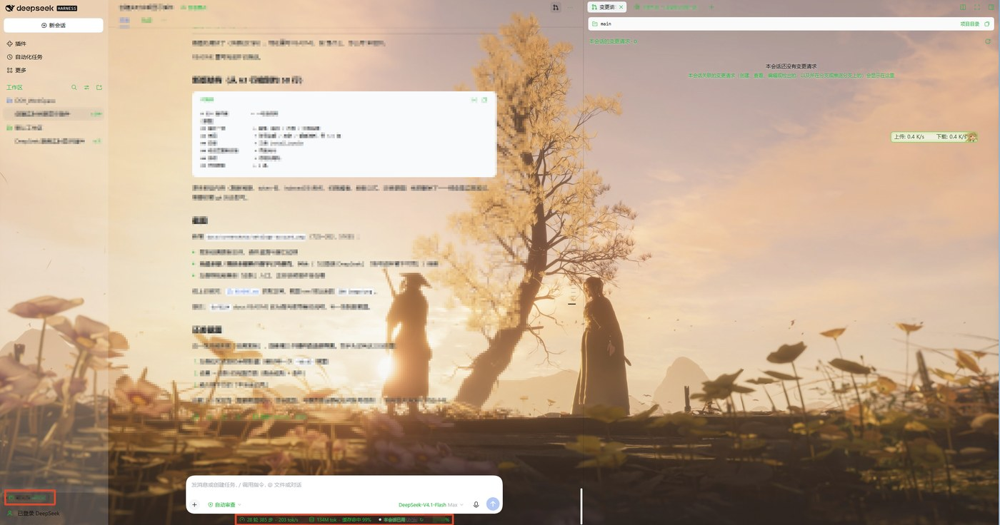

# DSH 插件集

给 DeepSeek Harness 的 Web 界面补四个小功能：**侧边栏账号余额**、**整站皮肤（可换背景图）**、**会话额度消耗**、**侧边栏 Markdown 编辑器**。



<sub>背景图与玻璃面板来自「皮肤」；左下角红框是侧边栏余额胶囊，输入框下方红框是本会话消耗。</sub>

## 插件一览

| 插件 | 作用 | 出现在 |
|---|---|---|
| [`账号余额`](dsh-account-balance) | 随时看到账号余额，消耗时浮出增量 | 左侧边栏底部 |
| [`皮肤`](dsh-skins) | 多套配色、自定义背景图、文字对比度 | 设置 → 皮肤 |
| [`额度消耗`](dsh-quota-meter) | 本会话已花多少额度 | 输入框下方 |
| [`Markdown 编辑器`](dsh-markdown-editor) | 在文件预览里直接改 Markdown：所见即所得 / 分栏 / 源码 / 预览 | 右侧边栏文件预览 |

四个插件互相独立，可以只装其中一个。

## 使用

### 账号余额

侧栏底部常驻显示 账户余额，分为充值额度与赠送额度。

- 点击立即刷新，悬停可看充值余额、赠送余额与更新时间
- 页面可见时每 30 秒自动刷新
- 侧栏收窄成图标栏时只留钱包图标，金额在悬停提示里
- 未登录、读取失败都有独立提示，点一下重试


### 皮肤

设置 → 皮肤，三块内容：

- **配色皮肤**：默认 / 极光青 / 暖沙 / 森林 / 霓虹紫，每套都有浅色和深色两版，跟随「通用设置 → 外观」的明暗选择。
- **背景图**：选本地图片，或粘贴图片链接。
  - 本地图片自动压到最长边 2560；带透明通道的图会保留透明（不再被填黑）
  - 图片链接按原图加载，不占本机存储
  - 可调 `暗化`（蒙层深浅）、`面板通透度`（卡片/侧栏有多透）、`遮罩浓度`（打开设置时背景雾化程度）
- **文字**：`面板明暗` 决定玻璃底是深是浅，`文字配色` 决定文字颜色（自动 / 高对比 / 柔和 / 自定义取色），专治背景图上的灰字看不清。

### 额度消耗

输入框下方显示 `本会话已用额度`，任务运行时自动刷新，任务结束后补读一次。

统计方式：账号余额是各会话共用的，所以按"**这段时间里谁在跑**"来分摊——两次读数之间余额下降多少，就记在期间运行过的会话上；充值、退款导致的余额上升不计入消耗，也不会清零已有数字。多个会话同时运行时按会话均分，是估算而不是账单。

### Markdown 编辑器

在右侧边栏预览 Markdown 时直接编辑，四种模式随时切换（会记住上次的选择）：

- **所见即所得**：内置 Vditor 的即时渲染模式，接近 Typora——在渲染结果上直接改，输入 `# `、`**`、`- ` 这类语法时当场成形。
- **分栏**：左源码、右实时渲染（插件自己的渲染器）。
- **源码 / 预览**：各看一边。

Ctrl/Cmd+S 或「保存」写回同一个文件；磁盘文件被改动时按钮变成「覆盖保存」，检测到外部修改会提示并可重新加载。文章开头的 YAML frontmatter 会原样保留；相对路径与本地图片按源文件所在目录经鉴权文件路由显示。

编辑器运行时（Vditor，MIT 协议）随插件放在 `vendor/` 目录、由插件本地提供，**不访问 CDN**。

## 安装

前提：已安装 DeepSeek Harness，并能使用插件管理器（`plugin_manager`）。

```
plugin_manager install_bundle target=<本仓库路径>/dsh-account-balance
plugin_manager install_bundle target=<本仓库路径>/dsh-skins
plugin_manager install_bundle target=<本仓库路径>/dsh-quota-meter
plugin_manager install_bundle target=<本仓库路径>/dsh-markdown-editor
```

装完刷新页面即可看到效果；插件的开关也在 设置 → 插件 里。

## 修改后重新安装

改代码后必须重装一次，浏览器才会加载新的客户端包：

```
plugin_manager remove_bundle  target=@local/dsh-account-balance
plugin_manager install_bundle target=<本仓库路径>/dsh-account-balance
```

（只改 `index.js` 这类 Host 端代码时无需重装。）

Markdown 编辑器多一个构建步骤：它改的是 `dsh-markdown-editor/src/client.js`，需要先编译出 `client.js` 再重装：

```
cd dsh-markdown-editor/build
npm install
node build.mjs
```

## 说明

- 账号余额、皮肤、额度消耗只用浏览器本地存储（`localStorage` / IndexedDB），不上传图片、不联网保存数据；Markdown 编辑器只读写当前会话工作区里的文件，不联网。
- Markdown 编辑器内置的 Vditor 为 MIT 协议，版权与第三方库清单见该插件目录下的 `THIRD-PARTY-NOTICES.md`。
- 余额通过 Harness 自带的账号接口读取，浏览器侧拿不到登录凭据。
- 皮肤、壁纸、文字配色按浏览器保存，换浏览器或清缓存会回到默认。

## 已知限制

- 背景图依赖界面用 `--dsw-alias-bg-base` 铺画布，个别自带不透明底色的区域不会透出图片。
- 远程图片若不允许跨域读取，无法测量亮度，此时「自动」文字配色退化为跟随外观明暗。
- 窄窗口（<768px）下设置面板铺满视口，不参与浮层雾化。
- Markdown 编辑器只能编辑当前会话工作目录里已存在的 Markdown 文件（不新建、单文件上限 2 MiB），且只对运行中的会话可保存。
- 所见即所得模式保存时按编辑器自己的序列化写回，列表符号、表格对齐等可能被规范化；需要逐字节保真时请切到「源码」。
